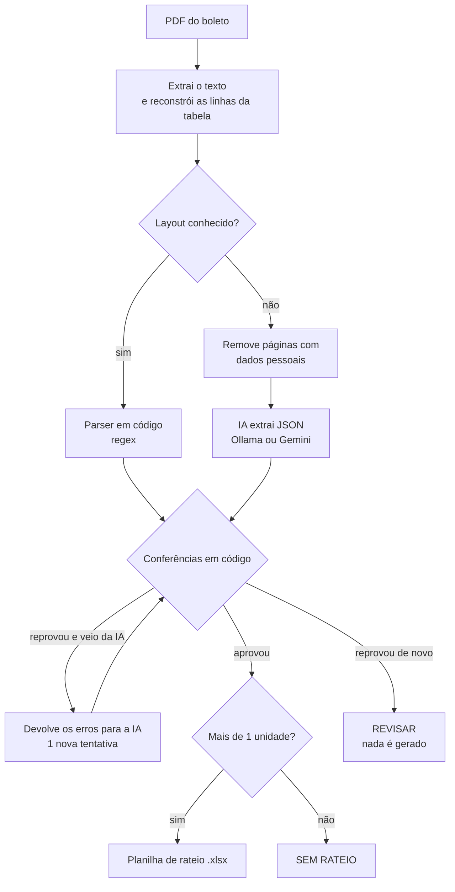

# Leitor híbrido de boletos (código + IA)

Projeto de estudo: lê boletos e faturas em PDF de **várias operadoras, cada uma com um layout diferente**, e divide o valor entre as unidades da empresa (rateio).

- **Layout conhecido:** o **código** lê o boleto. É grátis, rápido e exato.
- **Layout desconhecido:** uma **IA** lê o boleto e devolve os dados num formato fixo (JSON).
- **Nos dois casos:** o **código confere** a resposta antes de gerar qualquer planilha.

Tudo roda **sem gastar dinheiro**. A IA pode ser um modelo rodando no seu próprio computador (Ollama) ou a camada gratuita do Gemini.

> ⚠️ **Todos os dados deste repositório são fictícios.** Isso inclui as operadoras, a empresa, os CNPJs (só os dígitos verificadores são válidos), os nomes e os valores. Os PDFs são gerados pelo `gerar_exemplos.py`.

---

## Como funciona



### 1. Ler o PDF (`leitor/pdf.py`)

O PyMuPDF extrai o texto do PDF. Numa tabela, a extração comum devolve **uma célula por linha**, o que confunde modelos pequenos. Por isso o código agrupa as palavras pela altura em que aparecem e reconstrói cada linha da tabela:

```
Aeroporto   11.222.333/0005-05   6   299,40   45,00   0,00   344,40
```

### 2. Identificar o layout (`leitor/parsers.py`)

Cada layout conhecido tem uma **assinatura**, que é uma regex com um texto que só aparece nele. Se alguma bater, o parser em código daquele layout é usado.

### 3. IA para o que é novo (`leitor/ia.py`)

O programa envia para a IA três coisas:

- as **instruções** (o que extrair e as regras);
- o **JSON Schema** da resposta. No Ollama, o próprio servidor obriga a resposta a seguir esse formato ("structured output");
- o **texto do boleto**, **sem as páginas com dados pessoais**: nomes e datas de nascimento nunca saem do computador (minimização de dados, LGPD).

A IA devolve:

```json
{
  "operadora": "VidaDent Saude Bucal S.A.",
  "apolice": "VD-2026-0457",
  "valor_total": 1068.30,
  "cnpj_pagador": "11.222.333/0001-81",
  "subfaturas": [
    {"sub": "", "cnpj": "11.222.333/0005-05", "valor": 344.40},
    ...
  ]
}
```

A chamada é um **HTTP POST simples** (`urllib`, da biblioteca padrão). Não usa SDK de nenhum provedor, então dá para ver exatamente o que vai e o que volta.

### 4. Conferir tudo em código (`leitor/validacao.py`)

A IA **erra de vez em quando**. Por isso nenhuma resposta vira planilha sem passar por estas conferências:

| Conferência | Pega o quê |
|---|---|
| Soma das subfaturas = total | Coluna errada, unidade esquecida ou repetida |
| Cada valor **aparece escrito no PDF** | **Alucinação** (número inventado) |
| Dígito verificador do CNPJ | CNPJ lido errado |
| Unidade existe no cadastro | Sub ou CNPJ que não pertence à apólice |

### 5. Tentar de novo (o "agente")

Se a conferência reprovar uma resposta da IA, o programa devolve os erros encontrados para ela ("a soma deu X, mas o total é Y") e pede uma correção. É **uma** tentativa a mais. Se reprovar de novo, o boleto vai para **revisão humana**.

Esse ciclo (agir → conferir → corrigir) é a ideia central de um agente. Aqui ele é controlado pelo código: a IA não decide sozinha o que fazer.

---

## Os boletos de exemplo

| Arquivo | Operadora (fictícia) | Layout | Quem lê | Resultado esperado |
|---|---|---|---|---|
| `sorriso_900101.pdf` | Sorriso Pleno | Fatura técnica, uma página por sub | Código | Rateio em 3 unidades |
| `sorriso_900102.pdf` | Sorriso Pleno | Igual, com 1 sub só | Código | Sem rateio |
| `vidadent_VD-2026-0457.pdf` | VidaDent | Tabela com CNPJ e várias colunas de valor | IA | Rateio em 3 unidades |
| `vidadent_VD-2026-0458_com_erro.pdf` | VidaDent | Igual, mas o **total impresso não fecha** | IA | **REVISAR** (erro proposital) |
| `maisdente_G-3310.pdf` | Mais Dente | Texto corrido, com créditos e descontos | IA | Rateio em 3 unidades |

O cadastro de unidades (apólice + sub → CNPJ) fica em `dados/cadastro_unidades.csv`.

---

## Como rodar

### 1. Instalar (Python 3.10 ou mais novo)

```bash
py -m pip install -r requirements.txt
py gerar_exemplos.py
```

### 2. Escolher a IA (as duas são gratuitas)

Copie o `.env.exemplo` para `.env` e escolha uma das opções.

**Opção A: Ollama (roda no seu PC, offline, 100% grátis)**

```bash
winget install Ollama.Ollama
```

```bash
ollama pull qwen2.5:3b
```

- O modelo `qwen2.5:3b` ocupa cerca de 2 GB e roda até sem placa de vídeo, só que mais devagar.
- Em PC sem GPU, conte com **alguns minutos por boleto**.
- Modelos maiores (`qwen2.5:7b`) acertam mais, mas pedem mais memória.

**Opção B: Gemini (camada gratuita, muito mais rápido)**

1. Crie uma chave em <https://aistudio.google.com/apikey>.
2. Coloque no `.env`: `IA_PROVEDOR=gemini` e `GEMINI_API_KEY=...`.

> Na camada gratuita, o provedor pode usar o que você envia para melhorar os produtos dele (confira os termos atuais). **Use só com dados fictícios**, como os deste repositório.

### 3. Processar

```bash
py processar.py
```

Outras formas de rodar:

```bash
py processar.py --ia nenhuma
```

Sem IA: os layouts desconhecidos vão para revisão.

```bash
py processar.py --forcar-ia
```

Manda até os layouts conhecidos para a IA e **compara** a resposta com a do parser. Assim dá para medir quanto a IA acerta.

```bash
py processar.py minha_pasta --ia gemini
```

Os resultados ficam em:

- `saida/Rateio_<boleto>.xlsx`: a planilha de rateio, com uma conferência "OK/VERIFICAR";
- `saida/json/<boleto>.json`: o que foi extraído, por quem (código ou IA, e qual modelo) e quais problemas foram encontrados.

### 4. Testes (não precisam de IA)

```bash
py -m unittest discover testes -v
```

Os testes trocam a IA por uma "IA falsa" com respostas prontas. Assim dá para testar, sem internet e sem modelo instalado, os casos de:

- a IA acertar;
- a IA **errar e corrigir** na segunda tentativa;
- a IA **inventar** um valor;
- o documento vir inconsistente.

---

## Estrutura

```
gerar_exemplos.py      cria os PDFs fictícios e o cadastro
processar.py           programa principal (fluxo da figura acima)
leitor/
  pdf.py               texto do PDF + filtro de dados pessoais
  parsers.py           parsers em código + identificação de layout
  ia.py                chamada à IA (Ollama / Gemini), instruções e schema
  validacao.py         conferências e cadastro de unidades
  saida.py             planilha .xlsx e JSON de auditoria
  util.py              números BR, CNPJ, leitura do .env
testes/                testes com IA falsa
dados/                 cadastro de unidades (fictício)
boletos_exemplo/       PDFs fictícios
```

## Ensinando um layout novo ao código

Quando um layout novo aparece com frequência, vale "promovê-lo" de IA para código:

1. Rode com a IA e confira o `saida/json/` daquele boleto.
2. Escreva um `parser_<operadora>()` em `leitor/parsers.py`. A própria IA pode ajudar a escrever as regex.
3. Registre-o em `PARSERS` com uma assinatura.
4. Rode `--forcar-ia` para comparar o parser com a IA.

Com o tempo, a IA fica só para o que é realmente novo, e o custo e o tempo caem.

## Ideias para evoluir

- Ler PDF escaneado (imagem) mandando a página como imagem para um modelo com visão.
- Guardar as respostas aprovadas e usá-las como exemplos no prompt ("few-shot").
- Fila de revisão: uma tela simples para um humano corrigir os boletos marcados como REVISAR.
- Um agente "de verdade", em que a IA recebe ferramentas (`ler_pdf`, `consultar_cadastro`, `gerar_planilha`) e decide a ordem de usá-las.
